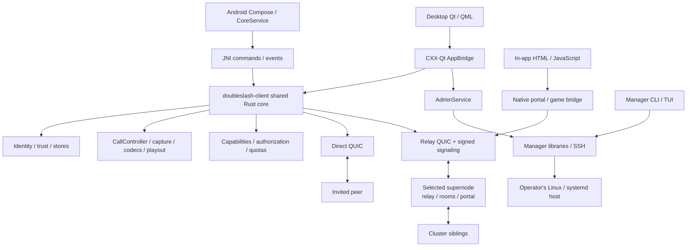

# DoubleSlash architecture

DoubleSlash is an invite-only peer-connectivity framework with desktop and Android
clients. Clients own identity, contact trust, saved rooms and conversation history.
A selected supernode provides signaling, relay transport, group-room hosting and
in-app pages. It is not an identity authority or a recipient of private participant
content. No central account, contact directory or presence backend is required.
Optional DDDNS supplies address hints for a supernode whose address changes.

This is the detailed explanation of the implemented system. The public
[architecture page](https://doubleslash.space/architecture.html) explains the same
model in everyday language. [Acceptance](ACCEPTANCE.md) records manual results;
[backlog.md](../backlog.md) owns unfinished work. Implemented code does not establish
that every hardware, installed-package or real-network scenario has passed.

## 1. Runtime components

The desktop binary enables the shared library's Qt UI and optional WebEngine
features. CXX-Qt exposes Rust state/commands to QML. Android builds without Qt,
uses a JNI session registry and exchanges ordinary commands/events as JSON with
Kotlin. Camera buffers and video surfaces have dedicated JNI methods; per-frame
media stays in Rust instead of crossing that JSON channel. Android's foreground
`CoreService` owns the unlocked session and notifications independently of
the activity.

`ConnectionManager` runs an asynchronous command/event loop for sessions,
routing, membership and recovery. `CallController` owns audio capture/playout
and call state. Video capture/encode/decode and file preparation/hash work use
dedicated workers; whole-file operations do not run on the manager loop. UI
consumers observe commands/events and stores instead of reimplementing transport.

| Workspace / source | Responsibility |
|---|---|
| [doubleslash-client](../rust/doubleslash-client/Cargo.toml) | Identity, stores, transport, calls/media, desktop bridge and QML |
| [doubleslash-android](../rust/doubleslash-android/Cargo.toml) + [android/](../android/) | JNI and Kotlin/Compose integration |
| [rust/](../rust/Cargo.toml) | Shared features, supernode, installer, Opus and VP8/VP9 wrappers |
| [doubleslash-supernode-manager](../rust/doubleslash-supernode-manager/Cargo.toml) | Independent SSH operations, CLI/TUI workspace |
| [web-sdk/](../web-sdk/) + [games/](../games/README.md) | Portal channel SDK and ephemeral applications |

Build from the intended workspace to load its local Cargo config; see the
[developer guide](../README.md#developer-guide).

## 2. Identity, profiles and storage

An identity is an Ed25519 keypair. Its URL-safe base64 public ID names the signing
key on signaling/membership paths; its hex SHA-256 peer ID is a separate local
lookup/conversation representation. Public-ID equality and ordering normalize
base64 padding. Names, IP addresses and hex peer-store keys do not substitute for
the public key.

The v2 `identity.dat` protects the seed with Argon2id-derived AES-256-GCM.
Unlock can use a passphrase and/or keyfile. Optional OS keyring/Android Keystore
integration protects a cached derived unlock key, never the passphrase. That key
plus the matching identity file can unlock the identity.

Desktop resolution checks `DOUBLESLASH_KEY_DIR`, then `DOUBLESLASH_HOME`,
otherwise `~/.doubleslash`. The collection's `active-profile` selects the
original or a restored profile under `profiles/<uuid>/`. One process owns
each selected profile; distinct profiles can run concurrently. Android sets its
app-private collection root before opening stores.

| Profile state | Representation / purpose |
|---|---|
| `peers.dat` | Encrypted contact trust/block records, names, supernode classification and connection hints |
| `my_rooms.dat` | Encrypted room definitions/credentials, owned Space trees, hiding/removals |
| `chat_history.db` | SQLite with encrypted message fields; history, attachment references and unread state |
| `device-key.dat` / `device-trust.db` | Local endpoint key / encrypted accepted registry rows, where present |
| `settings.json` | Desktop preferences; Android has separate device preferences |
| `managed_supernodes.dat` | Encrypted desktop SSH key, pinned hosts and deployment metadata; excluded from backups |
| Attachments and logs | Ordinary files outside message-field encryption; desktop `logs/doubleslash-client.log` is truncated at startup |

`open_with_key` allows store access using individual subkeys without signing
authority. Current storage keys still derive from the identity; independent
companion storage-key distribution is not implemented.

Sources: [identity.rs](../rust/doubleslash-client/src/identity.rs),
[peer_store.rs](../rust/doubleslash-client/src/peer_store.rs),
[room_store.rs](../rust/doubleslash-client/src/room_store.rs),
[chat_store.rs](../rust/doubleslash-client/src/chat_store.rs).

## 3. Connection lifecycle

### Invitations and contact trust

A personal invite contains signed identity, expiry, ephemeral X25519 material
and connection hints. Shareable links put the payload after `#` in
`https://doubleslash.space/i#...`; room links use `/r`. HTTP does not send
the fragment. The landing page previews it locally and hands it to the native
`doubleslash://` handler; the client validates it.

`ConnectionManager::generate_invite_url` records each personal invite in an
in-memory, single-use table with a 15-minute lifetime. The inviter accepts a signed
join only when it redeems an issued invite or comes from an already trusted peer.
A joiner's signature proves identity, not admission. Restart invalidates outstanding
personal invites; reusable node invites and room credentials have separate lifetimes.

The handshake checks signatures, ephemeral X25519 material, expiry and transcript
binding before HKDF session-key derivation. A sibling device's refusal remains
provisional during `INVITE_REJECT_GRACE` while the joiner waits for the minting
device's accept. Node classification comes from signed `is_supernode`, not URLs.

Within a room, a member can offer another member a personal invite inside a signed
`TrustRequest`, sealed to that recipient. The receiver checks current membership,
absence of any existing sender record, sender/invite identity and expiry, sanitized
handle and rate limits. Receiving only prompts; accepting uses the ordinary invite
flow. This exchange has membership/sealed-envelope checks outside the contact-trust
gate because establishing contact trust is its purpose.

### Node authentication and address discovery

A WebSocket is not yet an authenticated node session. The client sends a random
HELLO challenge; `await_hello_proof` checks expected identity, signature,
freshness and challenge. Early messages wait. Only after success can the manager
report `WsConnected` and replay room definitions/credentials. Bootstrap replies
prefer the live WebSocket so a stale prior-process QUIC writer cannot consume them.

Clients try saved/invite endpoints. A configured hostname supplies fallback:
DNS resolves at the known signaling port; DDDNS fetches a bounded HTTPS record with
IPv4/IPv6 and signaling port. Both still require the expected node's proof.
Relay tickets retain the advertised relay address.

### Direct transport, fallback and network changes

QUIC uses quinn/rustls with self-signed certificates and checks expected
identity/device claims. The client binds a dual-stack UDP socket with
`IPV6_V6ONLY` off. IPv6 unavailability permits IPv4 fallback; a taken/refused
port moves to the next port instead of opening an overlapping IPv4 socket.
Dialers accept IPv4 and bare/bracketed IPv6 literals.

A trusted connected node coordinates UDP hole punching through validated,
expiring registrations and a shared dial time; no STUN is used. Direct calls
allow five seconds for direct QUIC before requesting a temporary private SFU room
through a trusted connected node. Recovery or call end cancels pending fallback.
NAT/firewall restrictions can still prevent direct reachability.

Relay attachment uses signed tickets with a one-hour lifetime and ten-minute
renewal window. A persisted endpoint mailbox retains reconnection addresses for
24 hours, not messages. Android's `NetworkMonitor` reports `NetworkChanged`:
WebSockets redial, QUIC probes through a new endpoint handle on the same socket/port,
and a 15-second handover window retains room voice and a live relay to that room's
node. Reconnect replays the join; a relay receiving nothing since the move is
replaced. Window expiry restores ordinary loss/failover. Outside handover, losing
the WebSocket ends the room and drops its relay.

Sources: [invite.rs](../rust/doubleslash-client/src/connection_manager/manager/invite.rs),
[ws.rs](../rust/doubleslash-client/src/connection_manager/ws.rs),
[peer_session.rs](../rust/doubleslash-client/src/connection_manager/manager/peer_session.rs),
[handover.rs](../rust/doubleslash-client/src/connection_manager/manager/handover.rs),
[DDDNS protocol](DDDNS.md).

## 4. Capabilities and wire framing

Peers advertise descriptors through `CAPABILITY_ANNOUNCE`: ID/version,
channel kind, parameters, auth tier and experimental flag. Matching IDs and major
versions define compatibility. `FeatureRegistry` owns descriptors/modules
and quota state; feature trust and consuming manager/transport paths enforce
applicable authorization. Public, room-member and trusted-peer tiers have
different admission rules. Bespoke `x.<vendor>.*` features require client consent.

| Family | Capability IDs |
|---|---|
| Direct communication | `core.chat.v1`, `core.file.v1`, `core.audio.opus` |
| Direct presentation | `core.video.v1`, `core.audio.content.v1` |
| Group communication | `room.chat.v1`, `room.file.v1`, `room.audio.sfu` |
| Group presentation | `room.video.sfu`, `room.audio.content.sfu` |
| Endpoint routing | `core.devices.v1` |
| Hosted applications | `web.host.app.v1`, `game.relay.v1` |
| Transport | `transport.quic.*` descriptors |

Fixed tags multiplex the transport:

| Tag | Content |
|---|---|
| `0x00` | Control/signaling |
| `0x01` / `0x02` / `0x03` | Direct voice / chat / files |
| `0x04` / `0x05` | Room voice / game relay |
| `0x06` / `0x07` | Direct / room video |
| `0x08` / `0x09` | Direct / room shared audio |

Reliable peer frames carry a tag within transport length framing; datagrams use
their own boundaries. Dynamic tags occupy `0x10..0xEF`; `0xFF` is reserved
for broadcast. Media uses dedicated hot paths, not per-frame generic callbacks.

Inbound/outbound quotas are separate per feature/peer; fan-out accounts for copies.
Signaling writers share an 8 MiB queued-byte budget per identity, not per device.
Pacing, frame limits and bounded queues constrain pressure. Node forwarding of
ordered `SfuFileChunk`/`SfuFileComplete` observes quota refusal without
discarding those payloads so ordered downloads are not stranded; other classes
stay quota-gated. Manifest omission is not a blanket traffic-disable switch:
built-in descriptors also classify/account for relay traffic.

Sources: [descriptor.rs](../rust/doubleslash-features/src/descriptor.rs),
[registry.rs](../rust/doubleslash-features/src/registry.rs),
[channel_frame.rs](../rust/doubleslash-features/src/channel_frame.rs),
[wellknown.rs](../rust/doubleslash-features/src/wellknown.rs).

## 5. Message verification and encryption

Inbound signaling verifies Ed25519 canonical bytes and 300-second freshness,
then per-sender signature replay deduplication. SFU audio and receiver-idempotent
file chunk/completion classes skip deduplication, not signatures/freshness. Foreign
chat/call/file classes additionally require a trusted, nonblocked, nonrevoked
peer; sharing a relay does not authorize them.

| Path | Protection and node visibility |
|---|---|
| Direct signaling | Signed JSON over authenticated, encrypted peer QUIC; the direct path does not wrap every message in the invite-session cipher |
| Relayed peer signaling | `EncryptedSignal` seals peer-targeted content using a static identity-derived pairwise key; node/bootstrap/broadcast control can remain visible |
| Direct voice/video/shared-audio datagrams | Direct sessions use QUIC encryption; relayed direct datagrams add pairwise sealing against the node |
| Room chat, file chunks and media | Participant-held epoch keys seal content before the node receives it |
| Portal assets | Operator-supplied content, known to that operator |
| Game datagrams | Authenticated transport and scoped opaque forwarding; the SDK does not encrypt payloads against the relay |

The static pairwise construction has no forward secrecy; ephemeral invite key
agreement has a different scope. Node identity proof does not encrypt plain
`ws://` against an observer forwarding to the real node. Recipients can record
or redistribute what they receive.

Nodes can use peer/device IDs, room/session IDs, membership, routing indices,
message/control types, signatures, timing and byte counts. Room names and
file-offer/completion metadata may be visible. Nodes do not hold participant
room keys or retain private content for later delivery.

Sources: [routing.rs](../rust/doubleslash-client/src/connection_manager/manager/routing.rs),
[inbound.rs](../rust/doubleslash-client/src/connection_manager/manager/inbound.rs),
[crypto.rs](../rust/doubleslash-client/src/crypto.rs), [threat model](THREAT_MODEL.md).

## 6. Rooms, Spaces and clustered hosting

Saved rooms use `(supernode_id, room_id)` keys. Node SFU rooms are memory-only:
user-created rooms expire after 900 seconds without voice/text subscribers;
`default` remains. Reconnect materializes saved non-hidden definitions with
the room's certificate and stored token; `materialize_only` does not join voice.
Creation policy comes from `room.audio.sfu`, defaulting public off/private on.
Absent non-default rooms must satisfy that policy even on replay.

A room's owner signs a room certificate: id, name, type, invite policy, owner
and, for a private room, a hash of its join secret. The id derives from the
owner key and the name, so only the owner can certify it. Every member keeps
it: invite links, room lists, invite results and cluster rosters carry it, and
the client attaches it to each create, join, subscribe and invite. A node that
has forgotten the room recreates it from the certificate, whoever presents it,
with the certificate's type and owner rather than the request's. The secret
then admits any member on any node; a string the owner never committed to
admits no one. Without a certificate a node creates only the sender's own
room.

Space Layer 1 represents nested rooms as a signed Merkle tree with parent IDs,
signed roots, inclusion proofs and owner-signed grants. Private admission needs
validated proof/grant, the certificate's secret, a single-use node token, local
allowed state or creator admission. Room ID,
existence roster and contact trust alone are not membership grants. Invite policy
controls member invitations. Reserved key-hierarchy fields do not implement
Space Layer 2 cryptography.

Clusters link nodes through an including-self roster, authenticated QUIC and
signed control. Clients verify the trusted node's signed roster before using
sibling failover routes. Links carry the existence and certificates of rooms in
use, Space roots, peer trust and opaque room/game frames; private-room allowed sets are not replicated. Copies
are deduplicated and never re-replicated. Room video stays an opaque datagram
for room endpoints watching that sender, without a WebSocket media wrapper.

The UI groups a cluster under its representative node; unrelated nodes remain
separate. Routing chooses a live host in the relevant cluster. Voice leave goes
to every connected member because a prior join can remain on another sibling.
Only transient `room_absent` denials have bounded retry; other denials surface
immediately.

History has a different key: `chat_store::room_history_id` returns
`room:{room_id}` for user-created rooms and `room:default@{node}` for the
built-in room under the cluster representative. Legacy migration folds sibling
copies and adopts previously shared default history once. Unread/alert accounting
remains keyed by room ID. Desktop reads foreground-visible room text; Android's
service delivers opt-in room alerts. Local sends never alert; sibling messages
count as inbound but retain the user's bubble authorship.

Hide writes a local tombstone. Desktop Hide also leaves voice/unsubscribes;
Android Hide only changes visibility. Remove deletes the saved room, leaves voice,
unsubscribes and syncs removal to own devices; optional history deletion is local.
Neither action deletes the room for other people. Leaving voice keeps text selection.

Sources: [room_session.rs](../rust/doubleslash-client/src/connection_manager/manager/room_session.rs),
[space.rs](../rust/doubleslash-client/src/space.rs),
[sfu.rs](../rust/doubleslash-supernode/src/sfu.rs),
[cluster_link.rs](../rust/doubleslash-supernode/src/cluster_link.rs).

## 7. Room epoch keys and recovery

`SenderKeysGroup` holds room epoch keys. Election uses the authoritative
membership union across node snapshots and normalized public IDs: the lowest
identity is keyer, with device election among its endpoints. It need not be the
creator. First mint waits for another identity; the keyer distributes sealed keys
and rotates when membership requires it.

Receivers require the elected keyer. First real install accepts its offered
epoch; subsequent installs accept current or up to `MAX_EPOCH_ADVANCE = 64`
ahead with wrapping `u8` comparison. ACK/reseal delivery retries every 750 ms
up to 16 attempts, with bounded rearming for lagging members after that window.

A restarted/keyless member can remain in the union without a new membership edge.
It sends sealed `SfuGroupKeyRequest`, driven by membership sync and a retry
tick. Delay grows from 3 to 60 seconds but attempts do not stop. Listen-only members
observing newer unknown epochs also request recovery; every unopenable room-content
path records its epoch. Serving requires membership and the elected identity/device,
not contact trust, and returns the current epoch without competing with an in-flight
delivery.

If the keyer identity is our own on another device, recovery reopens the encrypted
own-device handoff with a fresh challenge and current roster. Malformed, late,
cleartext or conflicting replies fail closed. High-level sends require
`has_real_key`; the low-level deterministic epoch-0 fallback is not permission
to send. Failed opens are dropped. Voice retains its AAD; video adds `0x02`
and shared audio `0x03` for separate media domains.

Sources: [group_key.rs](../rust/doubleslash-client/src/group_key.rs),
[room key coordination](../rust/doubleslash-client/src/connection_manager/manager/room_session.rs),
[device_session.rs](../rust/doubleslash-client/src/connection_manager/manager/device_session.rs).

## 8. Calls, video, shared audio and files

### Real-time media

Voice flows through CPAL input, gain/noise/VAD and optional experimental AEC,
Opus encode, direct/room transport, per-sender jitter/decoder state and speaker
mixing. Push-to-talk/device controls depend on the client. Android uses Oboe and
platform audio routing. Explicitly started capture can continue while backgrounded;
ending the call/share stops it, while settings preview/test has its own lifecycle.

Video captures platform frames, composites optional PiP before encode, signs
frame metadata and fragments bounded encoded output into datagrams. Direct calls
negotiate H.264 where both support it, then VP9/VP8. Rooms default to VP9 and switch
a slow sender to VP8 for that session; explicit H.264 room preference requires
Windows receivers. Reassembly/decode is per sender/codec. Watched-peer subscriptions
control forwarding/decoding. Adaptive bitrate, frame ceilings and keyframe recovery
bound pressure.

Shared audio is separate from microphone voice. Windows WASAPI captures system or
application output; Opus content encoding carries sequence/PTS from the video
session clock. Receiver reordering/mixing supplies each sender's audio-led video
hold/drop anchor; camera-only video free-runs. Watched-peer gains are independent
of voice mute. Capture offsets use device time rather than frame counts so silence
does not stop the timeline. Android routes shared audio to CallController and
decoded video into attached native surfaces, outside UI JSON.

| Platform | Capture implemented | Boundary |
|---|---|---|
| Windows | Camera, screen/window, system/application audio | Full two-client/room media acceptance remains open |
| Linux | V4L2 camera | Hardware streaming acceptance pending; no screen/shared-audio capture |
| macOS | AVFoundation camera | Hardware acceptance pending; no screen/shared-audio capture |
| Android | CameraX camera | Opt-in VP9/VP8 video/shared-audio receive implemented; device playback acceptance pending; no screen/shared-audio capture |

Whole-screen sharing includes overlays/notifications. Windows application audio
falls back to whole-machine audio before build 20348. The client does not record
calls to disk. See [capture privacy](../PRIVACY.md#camera-screen-and-shared-audio-capture).

### File delivery

Direct files use reliable signaling; room offers advertise metadata, then requests
pull content from the originator. Targeted room frames reach the requesting
identity's endpoints, including the author's sibling device. An endpoint that
never held an offer stays silent instead of canceling its sibling's stream.
Revocation stops further serving but cannot recall delivered copies.

Files above `INLINE_MAX` (8 MiB) stream uncompressed without deltas, up to
4 GiB. Preparation and whole-file hashing run off the manager loop. A download
enters Verifying before publishing a checked path; canceled transfers ignore late
worker results. Stalled pulls retain partials and re-request from the first missing
chunk up to three times, then expose Retry. Protocol/size/hash failures discard
the partial. Offers last an hour; active progress has a separate idle timeout.
Transfers do not resume across client restarts; nodes have no file cache/offline queue.

Sources: [call_controller.rs](../rust/doubleslash-client/src/call_controller.rs),
[video/](../rust/doubleslash-client/src/video/),
[media_sync.rs](../rust/doubleslash-client/src/media_sync.rs),
[file_transfer.rs](../rust/doubleslash-client/src/file_transfer.rs),
[file_work.rs](../rust/doubleslash-client/src/connection_manager/manager/file_work.rs).

## 9. Multiple devices and backups

`device-routing` is a default shared-feature option advertising
`core.devices.v1`. Endpoints are root-authorized: each holds the full imported
identity and a separate local endpoint key. TLS/signaling claims bind root/device
IDs. Separate direct/relay routes, room subscriptions and stale-disconnect checks
preserve siblings/replacements. All participating clients/nodes must support this mode.

Calls fan out and select one answering endpoint with confirmation/retry. Losing
endpoints receive `CallAnsweredElsewhere`, stop ringing and do not count a
missed call; Android maps it to its existing call-ended event. Installed call-answer
acceptance is still open.

Sealed `DeviceRoomSync` is accepted only from another device of our identity.
It merges definitions, owned Space trees and removals. Explicit add/removal times
resolve conflicts; reconnect/list replay does not stamp a new add. Hidden rooms
stay hidden locally. A conflicting Space merge is signed above both epochs.
Clients sync on node connection, create and Remove; reply/behind state bounds
responses instead of answering replies indefinitely. This is not chat-history sync.

Message myself uses `core.chat.v1` for live text with local history.
Messages/acks/typing must be sealed, signed, fresh, addressed to our identity and
from a different non-empty device; acknowledgements target the sending endpoint.
Its pinned row/device count uses own-device presence, separate from contacts.
It has no calls/files, offline delivery, automatic replies or history sync.

`DeviceTrustStore` persists registries with predecessor, revocation, rollback
and fork checks; delegated registry authorization is not integrated into live
sessions. Entire-profile rollback cannot be detected by local version checks.
QR pairing, delegated removal and continuous history sync remain unfinished.
Current routing is not a completed device-linking product.

Explicit backups export the selected identity, stores, preferences and optional
available attachments as streamed `.dbackup` archives. Argon2id derives the key;
AES-GCM frames bind header/index. Restore checks the complete stream and extracted
stores/paths in staging, then publishes a separate selectable profile with a new
local passphrase. Endpoint keys, keyring entries, managed-server SSH credentials
and native plugins are excluded. Desktop settings stay pinned until restart.
Archive plus password grants full identity recovery, not a revocable companion
credential. Ordinary file moves require quitting the source before connecting
the destination. Limited simultaneous-use evidence and archive format details
are in [Devices and backups](DEVICES_AND_BACKUPS.md).

## 10. Portals, access gates and modules

Native scheme handlers serve `d://<node>/...` through authenticated QUIC bidi
`WebAppRequest`/response framing. Desktop WebEngine uses `doubleslash://`
to avoid Windows drive-letter URL interpretation; Android intercepts requests in
WebView. Portal readiness waits for relay readiness outside the manager loop.
Assets come from node `web/` and `games/<slug>/` paths. There is no public
HTTP/WebTransport game listener.

`window.doubleslash` provides a limited native channel bridge. Portal apps
join `game.relay.v1` sessions independently of SFU rooms and exchange bounded
datagrams; inbound data is polled. Cluster replication lets players on sibling
nodes share a session. Bundled examples keep state in open pages; guest IDs are
not verified peer identities or anti-cheat controls, and closing the last page
loses shared state. Native adapters are not permission to expose arbitrary client
commands to pages.

An operator can configure open, terms, code or timer admission. A portal-only
relay attachment permits the gate page before admission but not normal room,
relay-signaling or application-datagram use. Gate endpoints derive caller identity
from the authenticated connection; durable grants survive restart. Passing a node
gate does not establish contact trust or private-room membership.

Native modules load at startup through signed manifests/binaries and trusted-signer
checks. They run in-process; no native-code sandbox or plugin hot reload is
implemented. WASM isolation remains unfinished. Optional desktop Ollama sends
selected context to the configured endpoint; enabled tools use ordinary client
commands and constrained file sharing. It is off by default and is not an identity
or message backend.

Sources: [web_app_client.rs](../rust/doubleslash-client/src/web_app_client.rs),
[web_app_module.rs](../rust/doubleslash-supernode/src/web_app_module.rs),
[scheme.cpp](../rust/doubleslash-client/src/ui/scheme.cpp),
[web SDK](../web-sdk/doubleslash.mjs),
[access.rs](../rust/doubleslash-supernode/src/access.rs),
[loader.rs](../rust/doubleslash-features/src/loader.rs).

## 11. Administration and software delivery

The manager CLI/TUI and desktop `supernode_admin::AdminService` share SSH
libraries for Linux/systemd hosts. Desktop adds encrypted profile state, pinned
fingerprints, request IDs/progress and per-node task serialization. Setup installs
a key, applies selected baseline hardening, deploys and fetches the node invite.
Key-only login must succeed before optional password lockdown. Read-only import
discovers deployments; later hostname-only Apply validates identity, paths,
roster and concurrent changes before restarting exactly that instance. Android
administration is unfinished.

Nodes persist their own identity, peer trust, manifest, reusable invite, endpoint
mailbox, access grants and operator assets. Deployment must preserve these.
Cluster sync collects identities and renders rosters/member-restricted firewall
rules. Redeploy resolves rosters from inventory/cache and refuses accidental
declustering. The safe updater checks package hashes/notices, locks updates,
stages uniquely named builds, checks health and can restore the previous binary.
A basic CLI reinstall is a different operation. See the [manager guide](supernode-manager.md).

Unpackaged desktop builds poll GitHub when automatic checks are enabled and hand
updates to the standalone installer. Supplied stable manifests require project
Ed25519 signatures and matching archive hashes, but a stable install can proceed
without a manifest. Nightly requires a matching manifest hash and accepts an
unsigned manifest. Sidecars are checked when available. The node manager checks
SHA-256 sidecars/notices without the project signed-manifest verification.
Peer build attestations are signed claims, not proof of unmodified remote execution.

An MSIX process skips GitHub checks/installer handoffs; Windows manages package
updates and URI registration. It uses the same desktop profile/process lock.
Optional signing support in workflows does not prove an artifact was signed.
See [Updates](../README.md#updates), [Store packaging](MICROSOFT_STORE.md) and
[distribution notices](LICENSING.md).

## 12. Verification boundaries

The platform table identifies media limits; the device guide defines simultaneous-use
scope; the backlog owns administration, IPv6-only relay and DDDNS acceptance.
Optional service health/current release availability cannot be established from
source alone. The [threat model](THREAT_MODEL.md) covers residual risks and negative
paths. Record new build/environment results in [acceptance](ACCEPTANCE.md) rather
than copying dated pass/fail stories into this explanation.
