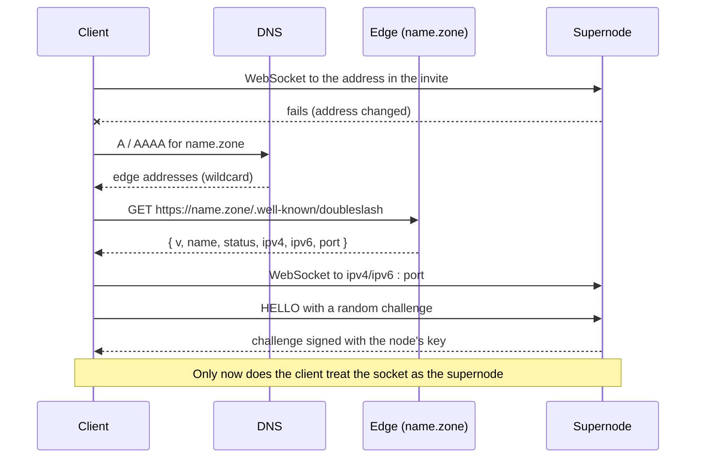

# DDDNS name-record protocol, version 1

DDDNS gives a DoubleSlash supernode a stable name, such as
`myserver.doubleslash.space`, whose current address a client can look up. This
document specifies the part a client sees: how it looks a name up, and the
record it gets back. Anyone can build a compatible name service or client from
it.

How names are claimed, paid for, and kept current is up to each service and is
not specified here. That covers accounts, update tokens, and how a supernode
reports a new address.

The key words MUST, MUST NOT, SHOULD, SHOULD NOT and MAY are used as in
RFC 2119.

## Overview



A **zone** is a DNS domain run for DDDNS, such as `doubleslash.space`. Every name
in the zone resolves, through one wildcard DNS record, to the service's own HTTPS
servers, called **edges**. An edge answers for any name with a JSON **record**
holding that name's current address. The DNS records never change when a
supernode moves. Only the record does.

A record is an address hint. It is never a credential (see
[Security](#security-considerations)).

## Names

A name is exactly one label followed by the zone: `<label>.<zone>`.

A label:

- is 3 to 63 characters long;
- uses only `a`–`z`, `0`–`9` and `-`;
- does not start or end with `-`;
- does not have `-` as both its third and fourth characters. This rules out
  `xn--` internationalised names, which could be used for look-alikes.

Names are case-insensitive. A client MUST lowercase the name and drop any
trailing dot before it looks the name up. A service MAY reserve labels for its
own use or to block abuse; those answer with status `reserved`.

A name with more than one label in front of the zone, such as
`a.b.doubleslash.space`, is not a DDDNS name. The zone apex is not a name either.

## Zone requirements

A service running a zone:

- MUST publish a wildcard `A` and/or `AAAA` record for `*.<zone>` pointing at
  its edges, and SHOULD NOT publish per-name DNS records;
- MUST serve HTTPS on every edge, with a certificate valid for `*.<zone>`;
- SHOULD publish more than one edge address, so a client can try the next
  address when one edge is down.

Because DNS for any name in the zone points at edges, a DNS answer for a DDDNS
name is never the supernode's address.

## The lookup hint

Whoever tells a client about a supernode marks a DDDNS name explicitly, with
this URI:

```
dddns://<name>
```

For example `dddns://myserver.names.example`. The hint is the scheme `dddns`
(case-insensitive), `://`, and the name, with nothing after it except an
optional trailing `/`. It carries no port: the record does. A hint with a port,
a path, a query, or a name with no zone after its label is unusable, and a
client MUST ignore it.

A client that holds a `dddns://` hint for a supernode, and cannot reach the
supernode at the address it already has, makes the
[lookup request](#lookup-request) for that name. It MUST NOT resolve the name
with DNS: for a DDDNS name, DNS answers with the service's edges.

A hostname given without this mark, such as `ws://relay.example.com:34935`, is
an ordinary DNS name. A client MAY still treat a name in a zone it knows to be
DDDNS as one. DoubleSlash clients do so for names under `doubleslash.space`, so
that `ws://<label>.doubleslash.space:<port>` hints from before `dddns://` keep
working.

Any zone works, because the hint names the service. Running a compatible
service needs a domain, the [zone requirements](#zone-requirements), and
supernodes that hand out `dddns://` hints for their names.

The hint should travel in something the client can authenticate, so that a
third party cannot add or change it. DoubleSlash signs it into the supernode's
invite and sends it in the node's signed `SupernodeInfo` (see
[Interoperability](#interoperability)).

## Lookup request

```http
GET /.well-known/doubleslash HTTP/1.1
Host: myserver.doubleslash.space
```

- The request MUST use HTTPS to `https://<name>/.well-known/doubleslash`, with
  the name as the TLS server name and the `Host`. The client MUST validate the
  certificate.
- The request carries no credentials, cookies or required headers. A service
  MUST answer without them.
- A client MUST NOT follow redirects. A service MUST answer at this URL
  directly.
- A client SHOULD bound the whole lookup with a timeout. The DoubleSlash client
  uses 5 seconds.

## Lookup response

| Situation | HTTP status | Body |
|---|---|---|
| Valid label, known or not | `200` | A record. An unclaimed name has status `available`. |
| Not a valid label (see [Names](#names)) | `404` | Optional `{"error": "<text>"}` |
| Anything else | Any non-2xx | Ignored |

A client MUST treat any status other than `2xx` as a failed lookup.

A service:

- MUST send `Content-Type: application/json` with a `200`;
- SHOULD send `Cache-Control: public, max-age=30` or shorter;
- SHOULD send `Access-Control-Allow-Origin: *`, so web pages such as an invite
  page can read records;
- MUST NOT set cookies;
- MAY send `DDDNS-Stale: <seconds>` when it is serving a copy of the record
  that it could not refresh for that many seconds.

A client MUST NOT depend on any of these headers.

### The record

```json
{
  "v": 1,
  "name": "myserver",
  "status": "active",
  "ipv4": "198.51.100.20",
  "ipv6": "2001:db8:1::20",
  "port": 34935,
  "updated_at": 1793577600
}
```

| Field | Type | Required | Meaning |
|---|---|---|---|
| `v` | integer | yes | Record format version. This document defines `1`. |
| `name` | string | yes | The label that was looked up: the first label of the requested name, lowercase. |
| `status` | string | yes | See [Statuses](#statuses). |
| `ipv4` | string | no | Dotted-quad IPv4 address. |
| `ipv6` | string | no | IPv6 address in RFC 5952 text, without brackets or zone index. |
| `port` | integer | no | The supernode's WebSocket signaling port, 1–65535. |
| `updated_at` | integer | no | Unix time, in seconds, when the address last changed. Informational only. |

(The addresses above are from documentation ranges. A real record carries public
addresses only; see [Addresses](#addresses).)

Rules for a service:

- `name` MUST equal the first label of the request's `Host`, lowercased.
- A record with status `active` or `grace` SHOULD carry `port` and at least one
  of `ipv4` and `ipv6`. It MAY lack them, for example before the supernode has
  first reported an address. Clients then treat the lookup as failed.
- A record with any other status MUST NOT carry `ipv4`, `ipv6`, `port` or
  `updated_at`. In particular, it MUST NOT carry a previous owner's address.
- One `port` applies to both addresses.

A client MUST ignore fields it does not know. Version 1 fields keep their
meaning; a change that breaks that needs a new `v`.

### Statuses

| Status | Serves an address | Meaning |
|---|---|---|
| `active` | yes | Claimed and in good standing. |
| `grace` | yes | Claimed, renewal overdue. Still served for now. |
| `available` | no | Not claimed. Also the answer for an unknown name. |
| `reserved` | no | Held by the service; cannot be claimed. |
| `pending_payment` | no | Claim started, not complete. |
| `expired` | no | Claim lapsed after its grace period. |
| `suspended` | no | Withheld by the service's operators. |
| `quarantined` | no | Recently released; resting before anyone can claim it again. |

A service MAY use statuses not listed here. A client MUST treat every status
other than `active` and `grace`, including ones it does not know, as having no
address.

### Addresses

A service SHOULD publish only addresses reachable on the public internet. It
SHOULD refuse unspecified, private, loopback, link-local, carrier-grade NAT
(`100.64.0.0/10`), benchmarking (`198.18.0.0/15`), multicast, broadcast,
documentation, `240.0.0.0/4`, IPv6 unique-local and link-local addresses.
It should also unwrap an IPv4-mapped IPv6 address to IPv4 before checking it.

A client MUST discard unspecified and multicast addresses, and MAY discard any
other address it cannot use.

## Client processing

A client that holds a DDDNS name for a supernode:

1. Dials the supernode at the address it already has, such as the one in the
   invite. It looks the name up only when that dial fails, and only for a
   [`dddns://` hint](#the-lookup-hint) or a name in a zone it knows to be
   DDDNS.
2. Sends the [lookup request](#lookup-request). On a timeout, a TLS or HTTP
   error, or a non-2xx status, the lookup fails.
3. Reads at most a few KiB of body (the DoubleSlash client stops at 4 KiB)
   and parses it as a JSON object. The lookup fails if:
   - `v` is not `1`;
   - `name` is not the first label of the name it asked for;
   - `status` is not `active` or `grace`;
   - `port` is missing, 0 or above 65535;
   - neither `ipv4` nor `ipv6` holds a usable address of its family.
4. Builds dial targets from `ipv4`, then `ipv6`, each with `port`, dropping
   duplicates. For a `dddns://` hint the scheme is `ws`; for a name taken
   from a `ws://` or `wss://` URL, it keeps that scheme. An IPv6 address is
   bracketed in the URL.
5. Dials those targets. A failed lookup or failed dials leave the client on the
   original address, which it keeps retrying as it normally would.

A client MAY cache a record for no longer than its `max-age`. The DoubleSlash
client does not cache: it looks the name up again after each failed dial.

## Security considerations

- **A record is an address hint, never a credential.** The record is protected
  only by TLS to the edge, and the edge belongs to whoever runs the zone the
  hint names. A client MUST authenticate the supernode by other means once
  connected, so that a wrong or malicious record can make a connection fail
  but cannot make it trust a different node.

  A DoubleSlash client does this with its first message. Its HELLO carries a
  `challenge` of 32 random bytes. The supernode answers with a `hello_proof`
  message carrying the same challenge, signed with the node's Ed25519 key. The
  client checks that key against the one it already holds from the node's
  signed invite. Until a valid proof arrives, the client sends nothing else and
  does not treat the socket as that node. Without a valid proof within 10
  seconds, it closes the socket and tries the next address.
- **An eavesdropper can still relay.** The proof shows the node holds its key.
  It does not encrypt the connection. Over plain `ws://`, a host that relays
  the client's traffic to the real node passes the proof and can read and drop
  the unencrypted signaling, though it cannot forge the signed messages
  either side sends. Any on-path observer can do the same today; a malicious
  record lets an off-path party become one. Only an encrypted channel bound to
  the node's key would close this.
- **Lookups are optional.** A client MUST be able to connect without DDDNS, using
  the address it already holds. A DDDNS outage delays recovery from an address
  change; it never blocks a connection that would otherwise work.
- **No redirects.** Following one would let an edge send the client to an
  arbitrary host.
- **Bounded work.** A client SHOULD cap the response body size (a v1 record is
  well under 1 KiB) and the total lookup time.
- **Privacy.** An edge learns the client's address and which name it looked up.
  A service SHOULD keep request logs short-lived and SHOULD NOT tie lookups to
  accounts.

## Interoperability

A DDDNS service in any zone works with DoubleSlash clients once supernodes hand
out [`dddns://` hints](#the-lookup-hint) for its names. A DoubleSlash
supernode does so when its `hostname_lookup` setting is `dddns`
(`supernode_hostname_lookup`, or `hostname_lookup` in `supernode.toml`). Left
unset, it chooses `dddns` for names under `doubleslash.space` and `dns` for
any other name.

A DoubleSlash client learns the hint from the supernode's signed invite, as a
`supernode_relay_hints` entry, and from the node's signed `SupernodeInfo`,
whose `hostname` field comes with `hostname_lookup` set to `dddns` or `dns`.
Other systems can carry the `dddns://` hint however suits them.

The DoubleSlash client implementation is `dddns_hint`, `dddns_name`,
`classify_signaling_hint` and `dddns_endpoints_from_json` in
[`connection_fallback.rs`](../rust/doubleslash-client/src/connection_fallback.rs),
and `dial_targets_for`, `lookup_dddns` and `await_hello_proof` in
[`ws.rs`](../rust/doubleslash-client/src/connection_manager/ws.rs). The
supernode builds the hint in `hostname_hint`
([`config.rs`](../rust/doubleslash-supernode/src/config.rs)) and signs the
proof in `hello_proof_payload`
([`main.rs`](../rust/doubleslash-supernode/src/main.rs)).
